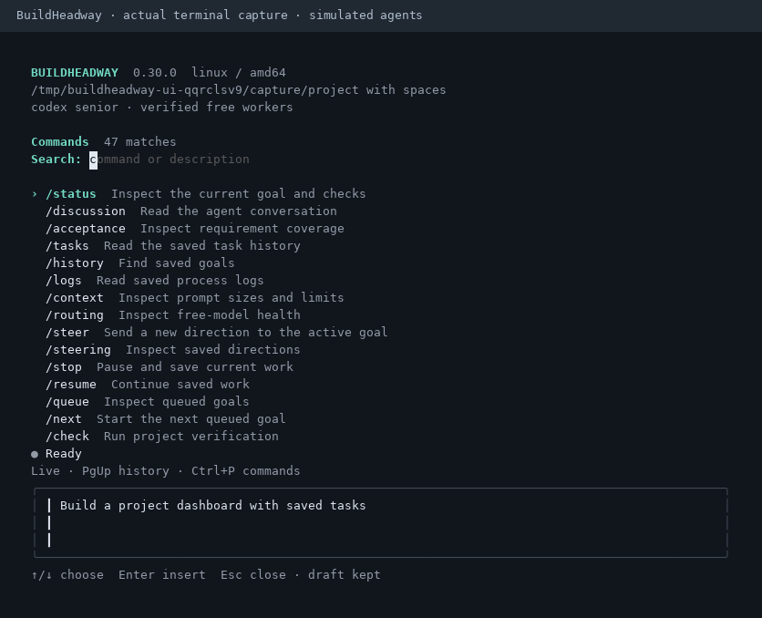
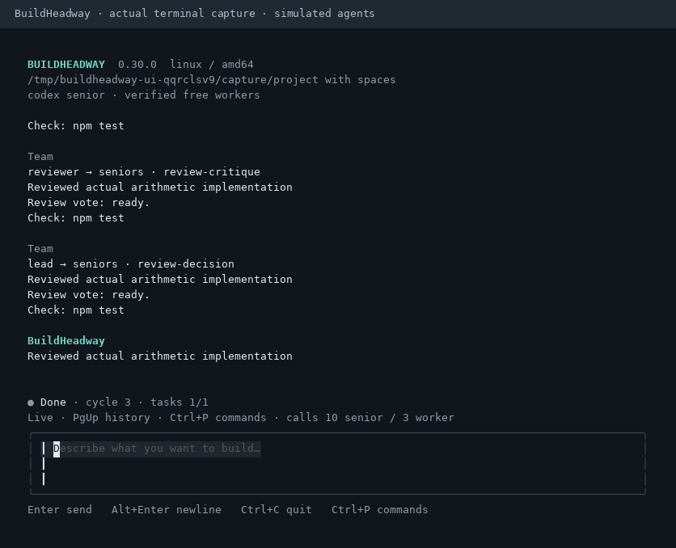

# Terminal interface

Run `buildheadway` in your project to open the conversation. The interface shows the selected connection, harness phase, repair cycle and completed tasks. Larger windows also show senior/worker call counts from the latest progress event. These observations do not replace verification or senior approval.

This preview is rendered from an actual Linux terminal integration capture with simulated agents. It is not evidence of authenticated model inference or manual Windows/macOS terminal testing.

## Find a command

Press **Ctrl+P**, or type `/commands`, to open the command palette. Search by command name, then use Up/Down to choose a result. Enter or Tab inserts it into the editor. Review the command, add any arguments, and press Enter again to run it.

Selecting a palette result never executes a command. Searching uses a fixed list of built-in syntax; it does not read project configuration, enumerate providers, access credentials, discover models or call agents. Use `/workflows`, `/extensions` or `/mcp` to inspect your customization through their normal commands.

Esc closes the palette without changing your draft. If you select a command while composing a goal, the original draft is kept in memory: Esc restores it before execution, and submitting the selected command restores it afterward. Selecting another command retains the original draft. Draft recovery is local to the open app; drafts are not checkpoints and do not survive quitting.

## Read history while work continues

Page Up/Down, Ctrl+U/Ctrl+D and the mouse wheel scroll the conversation. Scrolling away from the bottom holds your position while new messages arrive. The status area shows how many new entries arrived. **Ctrl+End** returns to live output; scrolling back to the bottom also resumes following. Ctrl+Home goes to the beginning of the retained transcript.

Reading history does not pause agents, checks, retry waits or budgets. Ctrl+C and `/stop` still request a pause while a goal is active, including when the palette is open. Ctrl+C closes the app when idle.

The interface retains up to 400 transcript entries. If older entries are removed, retained visible messages stay anchored where possible; an entry that has itself expired cannot remain visible. Full recorded run evidence remains available through `/discussion`, `/logs`, `/report` and the [inspection commands](usage.md).

## Resize and keyboard controls

The layout adapts its margins, editor height and status details to the window. Long paths and status labels are shortened to fit display columns; Unicode text and ANSI styling are handled by display width rather than byte count. Connection/model lists keep the selected item visible.

Below 20 columns or 10 rows, a resize hint replaces the interactive layout. Hidden text cannot be submitted or edited; the existing draft and goal remain intact. Resize the terminal to continue. Ctrl+C still pauses or quits, and background work continues under its existing harness controls.

| Key | Action |
| --- | --- |
| Enter | Submit the editor; insert a selection while the palette is open |
| Alt+Enter or Ctrl+J | Insert a newline in the editor |
| Ctrl+P | Open or close the command palette |
| Esc | Close the palette, or restore a draft kept before command selection |
| Up/Down | Move through palette or connection choices; otherwise edit text |
| Page Up/Down, Ctrl+U/Ctrl+D | Scroll the transcript |
| Ctrl+Home / Ctrl+End | Oldest retained output / live output |
| Ctrl+C | Pause active work; quit when idle |

Terminal applications can reserve key combinations. If a shortcut is unavailable, `/commands` opens the palette and `/stop` pauses work. See [installation troubleshooting](install.md#path-and-terminal-troubleshooting) and [the recovery harness](harness.md) for supported environments and saved-run behavior.
