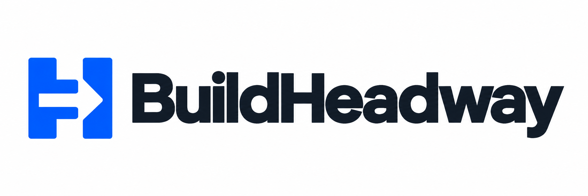

  

# BuildHeadway

A terminal coding agent for Windows, macOS, and Linux. MIT-licensed and open source.

Install it from your terminal, run `buildheadway` in your project, and describe your goal. BuildHeadway detects your coding agents, connects senior models, delegates implementation to free workers, runs checks, and continues through repairs and review.

## Install

With **Node.js 20+ and npm** installed, open a terminal in the folder containing the downloaded `.tgz` package:

~~~sh
npm install --global ./buildheadway-0.22.0.tgz
~~~

This same command works on Windows, macOS, and Linux. The package provides the `buildheadway` terminal command and includes native x64 and ARM64 builds. It needs no compiler or Python, downloads no extra binaries during installation, and also installs with npm lifecycle scripts disabled.

Then go to your project and give BuildHeadway a goal:

~~~sh
cd my-project
buildheadway "Build the app described in BUILDHEADWAY.md"
~~~

Run `buildheadway` without a goal to open the terminal conversation. On first launch, BuildHeadway scans this computer and shows installed agents inside the terminal. Choose your planner once; BuildHeadway prepares missing tools and opens native sign-in when needed. Then type what you want built. New goals automatically use the senior team, full access, and free implementation workers. Team discussion, verification, corrective tasks, checkpoints, and continuation are handled inside the terminal app.

This download is an installable npm release package. It has not been published to the public npm registry. See `source/docs/maintainers/publishing.md` in the source bundle for the remaining publication step.

For npm installations, removal uses:

~~~sh
npm uninstall --global buildheadway
~~~

Your settings and project checkpoints stay in your user data directory. A standalone native distribution is also included in the source bundle: from its folder, run `sh install.sh` on macOS/Linux or `./install.ps1` in Windows PowerShell, then run `buildheadway` from your project. The standalone distribution needs no Node.js for BuildHeadway itself.

## Large-output handling in 0.13

Long command logs stay on disk while memory capture is limited to 8 MiB. Oversized model responses stop for inspection rather than being mistaken for a complete reply or hiding earlier cost evidence.

## Model recovery in 0.12

BuildHeadway remembers free-model failures across tasks and restarts. Busy models get an increasing cooldown (15 seconds initially, capped at five minutes), while other healthy, freshly verified free models can continue the work. An explicit model choice stays pinned. Cancellation, steering and runtime budgets remain active during waits. Authentication, payment/quota, provider-policy and reported-cost failures stop the run.

`buildheadway routing`, `buildheadway routing --json` and `/routing` show per-model attempts, usable responses, failures, cooldowns and recent routing decisions. A usable response is transport/protocol success; project checks and senior review still determine whether the work is correct. Routing history also appears in exported reports.

When a failed worker changed source files, BuildHeadway checks and returns the partial work to the seniors before another implementation assignment. It does not immediately replay the assignment on a different model.

## Installation and completion checks

`buildheadway doctor` now diagnoses command resolution, native installation integrity, connection settings, project guidance and the verification shell. It executes isolated passing and failing quoted-command probes before declaring that shell usable, with no model calls or project changes. `buildheadway update --from PATH` upgrades from an extracted release. Releases built for a published repository also support `buildheadway update` and platform-specific internet installers. See [Installation guide](install.md) for Windows, macOS, Linux, update and troubleshooting instructions.

`buildheadway acceptance` and `/acceptance` show every retained requirement with its executable verification. Seniors connect requirements to checks, and completion is blocked until all coverage executes and passes. Checks that change source invalidate the round and cause all checks to run again. Root `AGENTS.md`, `CLAUDE.md` and `BUILDHEADWAY.md` guidance is shared with all agents. See [Harness guide](harness.md) for project acceptance configuration and the completion rules.

BuildHeadway was previously called Forge and Codentrail. Existing settings and project checkpoints remain supported; see [Identity compatibility](maintainers/naming.md). The approved logo and square icon are included in [Branding](branding.md).

## Reusable workflows and live direction

Start BuildHeadway and use `/review`, `/debug`, `/test`, or `/docs` for common tasks. `/workflows` lists these commands alongside your own Markdown templates and skills. Each starts the same autonomous team workflow, and its expanded instructions stay with the saved goal.

While the team works, `/steer Use SQLite locally` redirects the current goal. BuildHeadway applies it after the active agent call, discards stale plans and approvals, and inspects partial work before continuing. `/steering` shows waiting and applied updates. Ordinary messages while busy remain queued new goals.

From another terminal:

~~~sh
buildheadway workflow review "API compatibility"
buildheadway workflow --preview debug "login fails"
buildheadway steer "Use SQLite locally"
buildheadway steering
~~~

Projects can add repeatable `before_check` formatters and `after_check` validation gates in `.buildheadway.json`. Failed hooks go back to the team for repair and block completion; hooks that change source after tests trigger fresh verification. `buildheadway check` uses the same gates without calling a model.

See [Extensions guide](extensions.md) for template and skill folders, argument substitution, hook configuration, platform settings, and examples. No extra extension package is required for these features.

## Agent discovery

BuildHeadway scans PATH and common locations used by Homebrew, npm, nvm, fnm, Volta, Bun, pipx-style user bins, Scoop, WinGet links, and OpenCode's own installer. It displays actual executable paths and installed versions.

| Agent | Discovery | Built-in planner connection |
| --- | --- | --- |
| Codex | Yes | Yes |
| Claude Code | Yes | Yes |
| OpenCode | Yes | Yes |
| Pi | Yes, including current and existing pi commands | Yes, with compatibility check |
| Cline | Yes; editor extension and CLI are distinguished | Yes, for the CLI |
| Gemini CLI | Yes | Yes, including headless JSON responses |
| Qwen Code, Goose, Aider, Kilo, Amp, Droid | Yes | Detection only in this release |

A discovered command is not automatically treated as signed in or compatible. Selected connections are checked for the noninteractive features they need. Old incompatible installations are repaired with a private install rather than overwritten.

If a required connection is missing, BuildHeadway installs it into its own data directory. It can download and verify a private Node.js LTS runtime for these agent packages. Your existing system runtime and global packages are left alone.

On Windows, BuildHeadway also finds Git Bash or sets up an official, checksum-verified portable copy for the coding agents. It uses that copy only in its child processes; administrator access and a separate 7-Zip installation are unnecessary.

Codex and Claude sign in through their own CLI. Pi, Cline, and Gemini reuse their own configured providers; new installations open native setup. Credentials are not copied between agents. Cline's VS Code extension alone is not a terminal CLI.

## Figureout: give your coding team a goal

~~~sh
buildheadway figureout "Build a task tracker with search, dark mode, and tests"
~~~

Typing a goal, using `/goal YOUR GOAL`, or using `/figureout YOUR GOAL` starts the same autonomous team workflow. `buildheadway "YOUR GOAL"` also uses it in scripts and pipelines. Ordinary implementation choices do not prompt you. On a fresh CLI setup, BuildHeadway reuses an installed, authenticated Codex or Claude connection when available, otherwise uses verified free OpenCode planning. Missing required agent tools are installed privately. Existing configuration takes precedence.

To select premium seniors explicitly:

~~~sh
buildheadway attach codex --model gpt-6-astra --reasoning max --lead
buildheadway attach claude --model claude-opus-5-5
buildheadway team
buildheadway figureout "Build the app described in BUILDHEADWAY.md"
~~~

Model IDs and reasoning levels are passed to the selected account; they must be available to that account and client. `buildheadway attach gemini --model YOUR_MODEL_ID` adds a Google CLI senior. Provider models are configurable, not assumed to be installed or free. Attaching consumes no model inference. Additional attached seniors participate in each discussion; only explicitly attached connections join a configured team. `--name NAME` supports multiple reviewers using the same backend, and `buildheadway detach NAME` removes an attachment for future goals.

Without another attachment, BuildHeadway uses two separate lead/reviewer calls on the same connection and labels this clearly. This is not two independent model providers. Premium senior calls use your account's ordinary allowance; worker selection stays behind the refreshed zero-price catalog gate.

Agents can choose whom to consult before deciding. A senior can question another senior or a verified free coding peer; the recipient can consult a third teammate before answering. A worker can pause its assignment, ask a question or challenge an assumption, receive the actual reply, and continue from its saved work. Workers can also request replanning; BuildHeadway then checks the current files and returns to the senior team before dispatching dependent tasks. These are routed model calls with recorded replies, not invented dialogue.

Planning and review still require a lead proposal, each other senior's critique, and a lead decision. Dynamic consultations can happen inside any of those turns and during implementation. Workers run in order so dependent tasks do not edit the same project concurrently. A reviewer's rejection cannot be overridden by the lead: another implementation or verification round must follow. Completion requires unanimous review, acceptance criteria, executed passing checks, and an unchanged source snapshot. Obvious no-op checks such as `echo success` alone cannot qualify.

Internal recipients are named seniors, `@team` for all seniors, `@peer` for a verified free coding adviser, and `@worker` for implementation-model advice. You do not need to issue those messages yourself. Advice calls use the adapters' restricted planning controls. Each discussion allows eight routed advice calls before the agents must choose a concrete action or investigation. A worker can make up to eight consultation handoffs before unresolved work returns for replanning. These conversation limits prevent circular chat; the overall goal continues subject to its configured budgets and real service blockers.

~~~sh
buildheadway discussion
buildheadway discussion --json
buildheadway status
buildheadway report
buildheadway resume
buildheadway queue figureout "Implement the next feature"
~~~

The project saves the most recent 400 discussion messages, reply references, structured decisions, task attempts, and full child-process logs. A pending consultation and the worker's handoff are checkpointed before another agent runs. Restart resumes pending replies before continuing that assignment. Changed project files invalidate saved advice. Interrupted implementation is checked before further work; final review after restart reruns checks and obtains new votes. Team membership, worker connection, and access mode are pinned to the saved goal. Global connection changes affect new goals.

`figureout` has no default cycle or call cap and changes repair strategy when progress stalls. Explicit project/CLI budgets still apply. It runs while BuildHeadway is open until completion, interruption, a configured limit, or a real blocker such as missing authentication, quota, provider policy, or unavailable free models. `/stop` or Ctrl+C saves progress; `/resume` continues. It does not guarantee arbitrary app quality or bypass service restrictions.

Full access uses each adapter's native unattended permissions, including file and shell actions outside the project. The mode is shown when the run starts. To use BuildHeadway's ordinary adapter permissions instead:

~~~sh
buildheadway figureout --access workspace "Your goal"
buildheadway figureout --max-runtime 45m --max-planner-calls 30 "Your goal"
~~~

Workspace mode uses the existing adapter permission controls; these are not a uniform OS sandbox across all connected tools. Neither mode changes OS permissions or account/organization policies. Publishing, deployment, commits, and messages must be part of your explicit goal. Senior agents are instructed to coordinate and review; implementation belongs to workers.

## Normal use

~~~text
Build a task tracker with search, dark mode, and tests
~~~

The senior team reads the project, discusses uncertain decisions, assigns tasks to free OpenCode workers, answers their questions, runs project checks, reviews the result, and assigns repairs automatically. `buildheadway run "GOAL"` retains the explicit single-planner workflow for existing scripts; `/plan` and `buildheadway plan` remain planning-only.

| Control | Action |
| --- | --- |
| Enter | Send your message |
| /goal YOUR GOAL | Start a goal explicitly |
| /figureout YOUR GOAL | Start the default autonomous team workflow explicitly |
| /team | Show senior connections |
| /attach AGENT [MODEL] | Add an already-installed senior |
| /detach NAME | Remove a senior for future goals |
| /discussion [ID] | Read the saved agent conversation |
| Alt+Enter | Add a newline |
| Ctrl+C while working | Pause and save |
| /resume | Continue saved work |
| /resume ID | Reopen a particular saved goal |
| /status | See the phase, checks, and model-call counts |
| /acceptance | Show requirement coverage and executed evidence |
| /routing | Show free-model health, cooldowns and routing decisions |
| /tasks | Inspect task attempts across all repair cycles |
| /history [SEARCH] | Search saved goals for this project |
| /plan YOUR GOAL | Save a plan; use /resume to implement it |
| /init | Create project settings and BUILDHEADWAY.md |
| /config | Inspect settings for new goals |
| /check | Run project checks without a model |
| /diff | Show staged, unstaged, and untracked Git changes |
| /report [ID] | Read a run report |
| /export [ID] | Save a Markdown run report |
| /memory | Inspect saved project notes |
| /remember NOTE | Save a note for future goals and resumes |
| /buildheadwayt ID | Remove a saved note |
| /events | Show recent harness activity |
| /queue | Inspect the persistent project queue |
| /queue add GOAL | Save a goal for later |
| /queue run | Run queued goals in order until done or blocked |
| /next | Run one queued goal, or resume its checkpoint |
| /queue remove ID | Cancel a waiting goal; keep any checkpoint |
| /queue move ID POSITION | Reorder pending or blocked goals |
| /connect | Pick or repair a connection |
| /login | Complete required native sign-in |
| /agents | Inspect detected agents and paths |
| /models | Choose a verified free worker |
| /model ID | Choose your planner's model |
| /open FOLDER | Switch projects |
| Page Up / Page Down | Scroll |
| /quit | Close BuildHeadway |

Claude defaults to Opus. Codex, Pi, and Cline use their configured default model unless you choose another. Choosing OpenCode starts automatic free planning: unavailable or incomplete responses can fall back to another verified free model. The working planner is reused for review. `/model provider/model` selects an explicit planner instead.

Project test/build scripts are detected automatically. The planner supplies additional checks when needed. Completion requires an executed passing check and review approval; failed checks cannot be overridden by a worker claiming success.

## Harness and recovery

The harness manages the entire goal: plan, implement, verify, review, and repair. It saves a checkpoint **before** each worker starts and after every task and verification command. The task ledger retains titles, attempts, models, reports, failures, and timing across repair cycles. A task marked `reported` means the worker returned a report; goal completion still requires independent checks and planner review.

If a worker is interrupted or BuildHeadway crashes after an edit, `/resume` first runs checks and asks the planner to inspect the partial work. It does not blindly repeat the interrupted task. Saved checkpoints from earlier BuildHeadway releases migrate when resumed. `/history` and `/resume ID` let you return to an older goal. Resuming a completed goal also runs fresh checks and review.

Checks and success criteria remain in memory across batches. Newly created project manifests are detected before verification, so a project scaffolded during a goal gets its test/build commands automatically. A planner cannot remove an ordinary failing check by leaving it out of the next plan. An unavailable suggested command (exit 126, 127, or 9009) can be explicitly replaced with a recorded reason; the replacement must run before completion. Required checks cannot be replaced this way.

After checks, BuildHeadway fingerprints source content and compares it again before accepting review approval. If files changed during review, it verifies and reviews again. The snapshot excludes `.buildheadway`, `.git`, dependency/cache folders (`node_modules`, `vendor`, `.venv`, `venv`, `__pycache__`, `.pytest_cache`, `.mypy_cache`, `.ruff_cache`) and common generated output folders (`.next`, `.nuxt`, `.turbo`, `dist`, `build`, `target`, `coverage`). It records symlink targets without following them. Verification commands still run against the actual project. This detects changes within the snapshot's scope; it is not a filesystem sandbox or a guarantee that a test suite covers the whole goal.

Workers receive recent task reports and failed-check output. If a worker fails, the remaining ordered tasks wait for checks and a new review, so work that depends on the failed task is not dispatched blindly. The team sees the remaining tasks and recovery context. Default team goals change strategy after stalled rounds and keep going. The explicit single-planner `buildheadway run` workflow pauses after three additional unchanged verification rounds; `/status` explains the situation and `/resume` starts a fresh recovery attempt. Either workflow can set or disable that limit with `--max-stalled-cycles`. There is no default cycle or model-call cap in team mode.

The terminal shows the cycle and batch progress while working. `/events` keeps the latest 200 harness events; full task history and child-process logs remain under the project's `.forge/runs/` directory. Inspection commands also work from another terminal without connecting an agent. The project queue is saved to disk. Goals typed while a job is running join it automatically. After a normal goal succeeds, pending queued goals run in order. A failed or paused goal holds the remaining queue. Closing BuildHeadway preserves the queue; /next resumes its first unfinished goal, and /queue run drains it. Saving a plan or running standalone checks does not start waiting goals. No work runs while BuildHeadway is closed.

## Pause and resume from another terminal

While BuildHeadway is working, open another terminal in the same project:

~~~sh
buildheadway pause
buildheadway status
buildheadway resume
~~~

`pause` saves a request for the latest goal without connecting a model or waiting for the active project's run lock. The running controller cancels its active agent or verification command, retains partial work and diagnostics, and saves a `paused` checkpoint. Wait for that status before resuming; the pause command confirms that the request was saved, not that every subprocess has already stopped. Attached adapters must honor cancellation. A reported authentication, quota, policy, cost or oversized-output failure remains a blocker even if a pause arrives at the same time.

For a specific saved goal or another project folder, put flags before the run ID:

~~~sh
buildheadway pause --project /path/to/project --json RUN_ID
buildheadway resume RUN_ID
~~~

Repeated requests coalesce until an explicit start or resume acknowledges them. A request targets only its named goal; it does not cancel other saved goals. Completed goals refuse pause requests. A saved inactive goal may receive a request, but no process starts or stops on its own; the next explicit resume acknowledges the old request and continues. Inside the original terminal, `/stop` and Ctrl+C remain available.

Resume checks interrupted edits before another assignment and obtains fresh checks and senior review before completion. A paused queue holds later goals; use `buildheadway next` or `buildheadway queue run` to resume the same queued goal, then continue in order. BuildHeadway must remain open for work to run.

## Project setup, plans, and notes

`buildheadway init` creates `.buildheadway.json` and `BUILDHEADWAY.md` without replacing existing files. Put project conventions in `BUILDHEADWAY.md`; use `/remember` for short local notes. Notes are stored in `.forge/memory.json` and included in future goals and resumed work. `/buildheadwayt` removes a note from future context, while earlier checkpoints retain their recorded context.

An optional project configuration can include:

~~~json
{
  "version": 1,
  "checks": ["npm test", "npm run lint"],
  "context_files": ["docs/architecture.md"],
  "max_worker_calls": 30,
  "max_runtime_seconds": 7200,
  "check_timeout_seconds": 600,
  "planner_timeout_seconds": 900,
  "worker_timeout_seconds": 1800
}
~~~

Use commands appropriate to your project; the example assumes those npm scripts exist. `platform_checks` can add commands under `windows`, `darwin`, and `linux`. BuildHeadway also detects npm/pnpm/yarn/bun scripts, Go, Cargo, Maven, and common pytest projects. Explicit project checks are required gates. Each new goal captures its configuration so edits during a run cannot silently loosen its checks or limits. Resuming keeps that captured configuration; `BUILDHEADWAY.md`, selected context files, and saved notes are refreshed. Context files must remain inside the project, including after symlink resolution.

`max_cycles`, `max_planner_calls`, `max_worker_calls`, and `max_runtime_seconds` default to zero (no cap). Runtime budgets count active BuildHeadway execution across resumes, excluding time while the app is closed. Command timeouts are independent. CLI limits override project limits for that invocation; raise a limit with the matching flag when resuming a capped run. `max_stalled_cycles` defaults to three for ordinary goals and zero for figureout; an explicitly configured value takes precedence. Every senior proposal, critique, synthesis, and retry counts toward the planner-call budget.

`/plan GOAL` saves the planner's tasks, checks, and criteria without dispatching implementation workers or running the harness checks. Inspect `/tasks` or `/report`, then `/resume` to implement the saved plan. Planning still calls the selected planner and may use its permitted inspection tools.

`/check` runs configured, detected, and most-recent-goal checks without a model connection. Results are saved separately in `.forge/checks/` and `.forge/last-check.json`; they do not mark a goal complete. `/diff` is read-only and shows the current Git working tree, including pre-existing changes. Untracked files are listed by name. `/export` records the goal, task attempts, criteria, verification output, and recent events as a Markdown report.

## Free routing and account limits

Premium planner calls consume your normal account allowance. Free offers can expire or be rate limited.

Worker pricing is refreshed before each task. Only models with explicit zero input/output prices and no nonzero listed cache or other pricing fields qualify. Main, small/title, and worker-agent models are pinned. Plugins and agent delegation are disabled for worker runs. Failed repairs can rotate to another verified free model; temporary capacity errors retry automatically. Automatic free planning also checks the current catalog and stops on a reported charge.

There is no implemented paid-worker fallback. Reported catalog prices cannot enforce the provider's billing ledger. A reported nonzero worker cost pauses the run.

The app must remain running to work. Checkpoints survive closing or interruption. Authentication, missing quota, and other hard blockers are reported; the app resumes saved work after the required connection is repaired.

For explicit `buildheadway run` goals, figureout workspace mode, and internal consultations, the OpenCode planner uses a separate planning agent whose file-edit tools require approval, with auto-approval disabled. It can inspect files, maintain its internal todo list, list the project, and repeat exact verification commands that BuildHeadway has already executed. Other shell requests are rejected. Full-access team planning and implementation enable unattended native tools; consultations remain advisory. Review approval still cannot override BuildHeadway's own failing checks.

See **VALIDATION.md** for the actual native and live-service test results for this download. Provider capacity and your account access determine whether model calls are available.

## Useful terminal commands

~~~sh
buildheadway scan
buildheadway doctor --json
buildheadway --demo
buildheadway --self-test
buildheadway --version
buildheadway run "Your goal"
buildheadway run --resume
buildheadway resume
buildheadway resume RUN_ID
buildheadway pause
buildheadway pause --json RUN_ID
buildheadway status
buildheadway status --json
buildheadway tasks
buildheadway history
buildheadway events
buildheadway init
buildheadway plan "Your goal"
buildheadway config
buildheadway check
buildheadway diff
buildheadway remember "Keep the public API compatible"
buildheadway memory
buildheadway queue add "Add keyboard navigation"
buildheadway queue run
buildheadway next
buildheadway report
buildheadway export --output report.md
buildheadway export --json --output report.json
buildheadway history --search navigation --limit 10
buildheadway run --json "Your goal"
buildheadway run --max-worker-calls 20 --max-runtime 2h "Your goal"
buildheadway run --max-cycles 10 --max-planner-calls 12 "Your goal"
buildheadway run --max-stalled-cycles 5 "Your goal"
~~~

Place flags before positional text, queue actions, or run IDs: for example, `buildheadway queue --project PATH add "Your goal"`. Most inspection and project commands support `--json`; `buildheadway run --json` streams one JSON event per line. `buildheadway export --json` writes a full JSON checkpoint and prints its path as JSON. Exports refuse to overwrite an existing file unless `--force` is supplied. Run IDs appear in `/history` and `buildheadway history`. `--limit 0` lists all matching history entries.

The demo uses simulated agents and real native verification processes. It needs no model accounts or external runtime. It deliberately fails a check, repairs the calculator configuration, verifies again, and finishes after review.

For standalone installations, `buildheadway uninstall` removes the native command and its managed PATH entry. Npm installations use `npm uninstall --global buildheadway`; `buildheadway uninstall` shows that command.

## Platform support and verification

Native binaries are included for all six targets:

- Windows: amd64, arm64
- macOS: amd64, arm64
- Linux: amd64, arm64

The release's **VALIDATION.md** states which builds were actually executed. Cross-compilation alone does not establish OS compatibility. CI covers native tests and real npm installation, launch, upgrade, removal, integrity rejection, and preservation of user settings on Windows, macOS, and Linux when this source is hosted on GitHub.

This downloadable build is unsigned. OS trust/signing prompts may apply. macOS notarization and Windows code signing require release credentials; none are claimed for this build.

## Source and rebuilding

The source repository is [agentic-dev8k/buildheadway](https://github.com/agentic-dev8k/buildheadway). Downloadable distribution bundles also include it under `source/`. BuildHeadway uses Go and the MIT-licensed Bubble Tea terminal framework. The npm package has not been published to the registry.

~~~sh
go test -buildvcs=false ./...
go build -buildvcs=false -trimpath -o buildheadway .
~~~

Developers build the installable npm package and source bundle with Go, Node.js/npm, and Python:

~~~sh
python3 release.py --output dist
~~~

The release tooling cross-compiles native binaries, includes dependency licenses, records SHA-256 checksums, and uses `npm pack` to produce the actual installable package. It runs real npm install/launch/upgrade/remove tests before completing the release. The launcher verifies the selected binary before execution and inherits the terminal and working directory. Runtime downloads for missing agents use official Node.js HTTPS release assets and verify the matching SHA-256 manifest.

The normal test suite makes no model calls. Developers can explicitly enable the real free-service end-to-end test:

~~~sh
BUILDHEADWAY_LIVE_FREE_TESTS=1 go test -buildvcs=false -run TestLiveFreeGoal -v .
BUILDHEADWAY_LIVE_FREE_TESTS=1 go test -buildvcs=false -run TestLiveFreeFigureOutCouncil -v -timeout 14m .
BUILDHEADWAY_LIVE_FREE_TESTS=1 go test -buildvcs=false -run TestLiveFreeWorkerConsultationContinuesTask -v -timeout 14m .
~~~

These tests start with a failing Node.js fixture, ask real seniors to assign the fix, let a real free worker implement it, run the unchanged tests, and require review before completion. The conversation test also requires the worker to ask a question and receive the senior's actual reply before editing. They need Node.js, an installed compatible OpenCode CLI, network access, and an eligible zero-price model. `BUILDHEADWAY_LIVE_MODEL` selects a currently eligible model. Set `BUILDHEADWAY_LIVE_OUTPUT` to a directory to retain the conversation test's project and checkpoints for inspection.

On macOS or Linux, `python3 scripts/terminal_conversation_test.py /absolute/path/to/buildheadway` exercises the real terminal interface with simulated agent subprocesses and actual Node.js verification. It covers plain goal entry, worker consultation, continuation, review, discussion inspection, report export, queue persistence, and shutdown.

Implementation interfaces were checked against the current official documentation and real CLI help:

- [Codex CLI](https://developers.openai.com/codex/cli/reference/)
- [Claude Code](https://code.claude.com/docs/en/cli-reference)
- [OpenCode](https://opencode.ai/docs/cli/)
- [Pi](https://github.com/earendil-works/pi/blob/main/packages/coding-agent/docs/cli.md)
- [Cline](https://github.com/cline/cline/blob/main/apps/cli/README.md)
- [Gemini CLI headless mode](https://geminicli.com/docs/cli/headless/)
- [Codex reasoning configuration](https://learn.chatgpt.com/docs/config-file/config-reference)

MIT license for BuildHeadway. Connected tools, runtimes, and model services retain their own terms.

Inspect full saved command output with `buildheadway logs`, then `buildheadway logs LOG_NAME.log`. Use `buildheadway logs --last-check` for standalone verification, or `/logs` inside the terminal app. Checks, hooks, acceptance JSON and exports retain the exact log reference and identify output excerpts. See [Harness guide](harness.md#inspect-saved-logs).

Verification now checks source consistency at every command and review-hook boundary. If one command changes source, BuildHeadway invalidates that round before another command can restore the old files. Actual exit codes and logs are retained, and successful completion requires stable verification and fresh senior review.

Senior reviews and consultations use bounded worker-report excerpts with explicit references to full saved evidence. Long reports keep both their beginning and end, while saved reports and handoffs remain intact.
